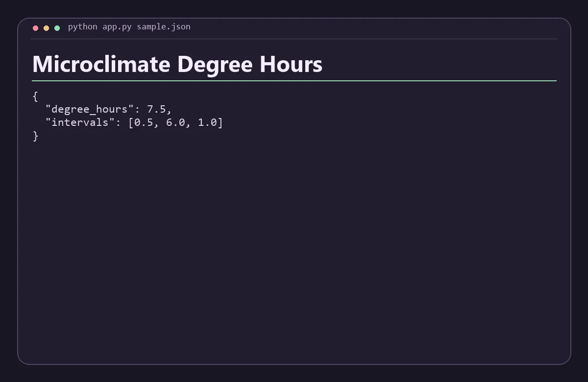

# Microclimate Degree Hours

Integrate temperature above a configurable threshold and see how much each interval contributes.



## Run

Install Python 3.11 or newer. Run these commands from the repository root.

```sh
python app.py sample.json
```

Replace `sample.json` with a JSON file following the same structure. The app prints a JSON report to standard output.

Enter elapsed hours and temperatures in one consistent unit. The model uses linear interpolation between samples and clips intervals exactly at threshold crossings.

## Verify

Run `python check.py` with Python 3.11 or newer after the build step when applicable. The check verifies the bundled scenario and confirms that an invalid input returns an error.
